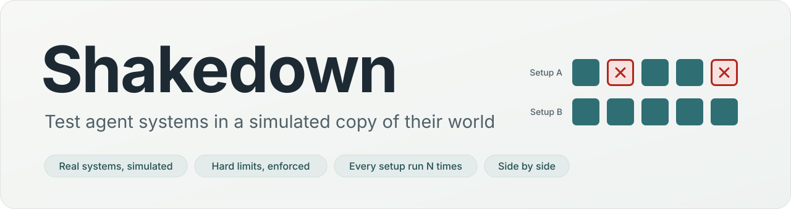
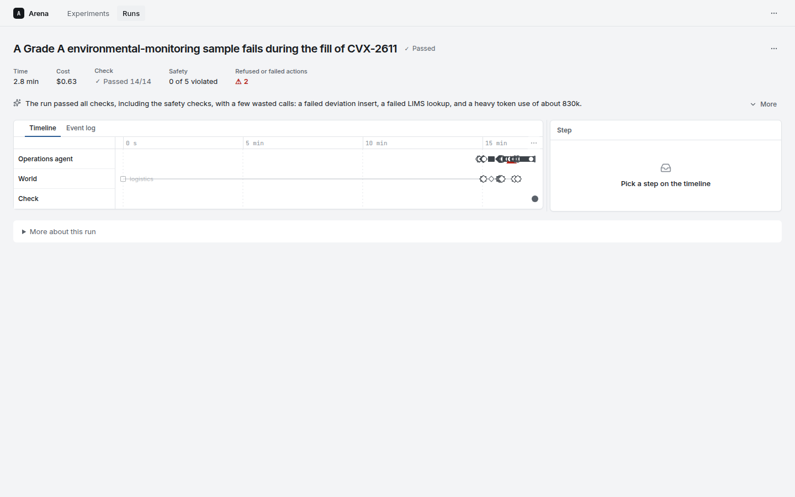
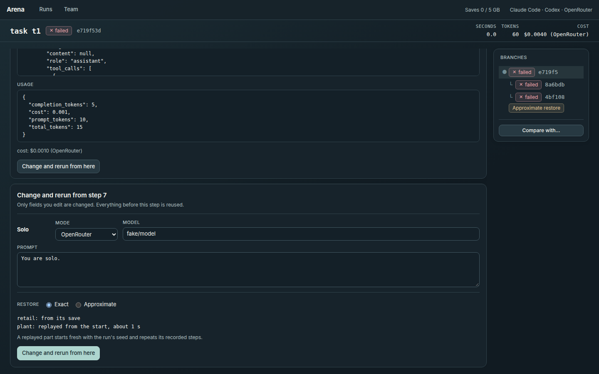
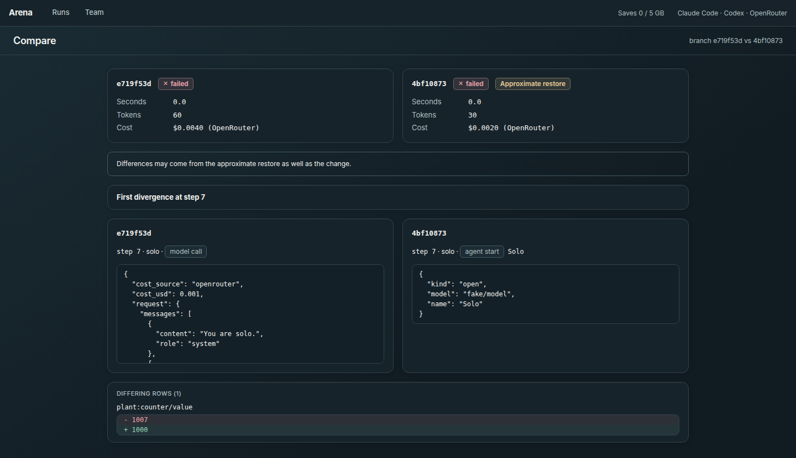
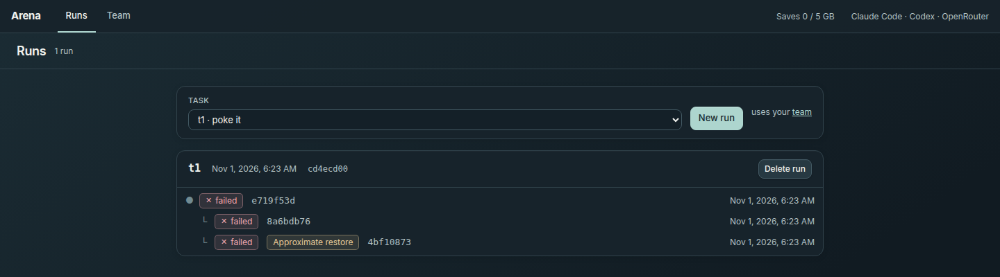
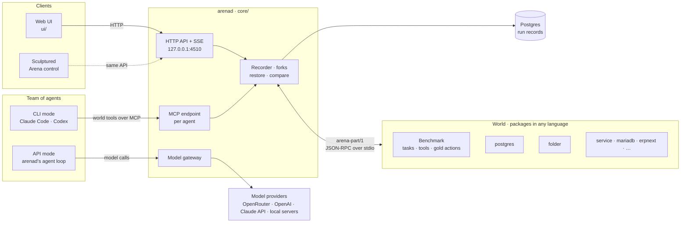

<p align="center">
  <picture>
    <source media="(prefers-color-scheme: dark)" srcset=".github/assets/banner-dark.svg">
    <source media="(prefers-color-scheme: light)" srcset=".github/assets/banner-light.svg">
    
  </picture>
</p>

<p align="center">
  <a href="https://github.com/Sculptured/Arena/actions/workflows/ci.yml"></a>
  <a href="LICENSE"></a>
  
  
  <a href="docs/protocol.md"></a>
</p>

<p align="center">
  <a href="#quick-start">Quick start</a> ·
  <a href="docs/concepts.md">Concepts</a> ·
  <a href="docs/protocol.md">Protocol</a> ·
  <a href="integrations/README.md">Integrations</a> ·
  <a href="docs/reference.md">Reference</a> ·
  <a href="CONTRIBUTING.md">Contributing</a>
</p>

**Arena is a rewindable arena for testing multi-agent systems.** A team of AI agents works on a task in a world
made of real systems: a database, a folder of files, a Docker Compose project, a simulator. arenad, the arena
service, records every step and saves the world as it was at that step. Go back to any step, change an agent's
prompt, model or harness, fork with an exact or approximate restore of the world, rerun from there, and compare
the runs.

## Why Arena

- **Rewind the world, not just the transcript.** After each step that changes the world, arenad saves the parts
  that changed (a part that can only replay is replayed instead). A fork puts each part back as it was just
  before the fork point, and the team continues from there.
- **Honest restores.** Each integration declares what it can do: an exact save, a deterministic replay, an
  approximate save, or nothing. A fork that can't restore a part in the mode you asked for is refused, naming
  the part; approximately restored branches are labelled in the run page, the branch list and compare.
- **Any harness, one team.** Run agents as headless Claude Code or Codex CLIs that see only the world's tools
  through an MCP endpoint (CLI mode), or in arenad's own loop with every model call recorded (API mode). Mix them
  in one team and swap one for the other in a fork.
- **Any model provider.** Each API-mode agent picks its provider: OpenRouter, the OpenAI API, the Claude API, or a
  model on your own machine through any OpenAI-compatible server (Ollama, vLLM, LM Studio, llama.cpp's server).
  A fork can move an agent to another provider or model.
- **Integrations work like device drivers.** Each kind of system is a separate program, in any language, that
  speaks `arena-part/1`: JSON-RPC over stdin and stdout. Rust and Python kits do the plumbing, and
  `arena-part-check` checks a new integration against the protocol.
- **Benchmarks are packages too.** A benchmark brings the tasks, tools, seed data and gold actions, and names
  the world it runs in. The core depends on no integration and no benchmark
  (`core/crates/parts/tests/isolation.rs` checks this).
- **Compare what changed.** Outcome, time, tokens and cost side by side, the first step where two branches
  differ, and the state that differs at the end.

## Screenshots

<table>
  <tr>
    <td width="50%"></td>
    <td width="50%"></td>
  </tr>
  <tr>
    <td><sub><b>Run.</b> Every step of every agent, its branches, and which were restored approximately.</sub></td>
    <td><sub><b>Change and rerun.</b> Edit an agent, pick a restore mode, and see how each part will be restored.</sub></td>
  </tr>
  <tr>
    <td width="50%"></td>
    <td width="50%"></td>
  </tr>
  <tr>
    <td><sub><b>Compare.</b> Cost, first divergent step, and the state that differs at the end.</sub></td>
    <td><sub><b>Runs.</b> Each run with its original branch and the forks made from it.</sub></td>
  </tr>
</table>

<sub>Captured from Arena's web UI on a small test world (a toy part and the kit's counter, with agents on a fake model).</sub>

## How it works



The world is made of **integrations**: isolated programs that each put one kind of system in the world and
speak the `arena-part/1` protocol with arenad ([docs/protocol.md](docs/protocol.md)). Each one starts
instances, runs tool calls, saves an instance's state, starts from a save, shows the state and compares two
states. A **benchmark** names the world it runs in (its **parts**) and brings the tasks, the tools, the data and
the gold actions. When a branch ends, arenad diffs its world with the task's gold world; it passes when no key
differs and at least one part could be checked. The web UI is one client of arenad's HTTP API; Sculptured's
Arena control workspace is another.

Read [docs/concepts.md](docs/concepts.md) for the full model: runs, branches, steps, saves, the restore table,
teams and handoffs, forking rules and cost labels.

## Quick start

This uses the included retail example benchmark (`benchmarks/retail`, customer service from tau2-bench retail,
on one `postgres` part), the default benchmark. You need Docker, Rust and Node; the `claude` and/or `codex`
CLIs on your PATH for CLI agents; for API agents, a key (`OPENROUTER_API_KEY`, `OPENAI_API_KEY` or
`ANTHROPIC_API_KEY`) or a local OpenAI-compatible server named in `ARENA_LOCAL_MODELS` (for example
`ollama=http://127.0.0.1:11434/v1`); `uv` only for the Python integrations.

```bash
git clone https://github.com/Sculptured/Arena.git && cd Arena
docker compose -f deploy/compose.yml up -d     # Postgres on 127.0.0.1:5544 (loopback only)
cargo build --release                          # the Rust integrations and benchmarks, into core/target/release
(cd core && cargo run -p arenad)               # API on http://127.0.0.1:4510
(cd ui && npm install && npm run dev)          # UI on http://127.0.0.1:4520 (proxies /api to 4510)
```

arenad keeps its records in the database `arena` on that Postgres. It starts the integration and benchmark
programs itself, from `ARENA_BIN_DIR` (default `core/target/release`), and refuses to start if the benchmark
can't be described (package missing or not built). It listens on 127.0.0.1 only. `GET /api/health` shows the
benchmark, which CLIs were found, each model provider and whether API mode is available, and the disk use;
`GET /api/providers` also asks the local servers and lists the models each provider offers.

Or build the UI and let arenad serve it:

```bash
(cd ui && npm install && npm run build)
(cd core && ARENA_UI_DIST=../ui/dist cargo run -p arenad)    # UI and API on :4510
```

Then:

1. **Start a run:** pick a task and a team. On the Team page each agent gets a mode, and an API-mode agent a
   provider and a model.
2. **Inspect:** click a step to see its arguments, its result, and the state it read or wrote, as it was at
   that step.
3. **Fork:** at a step, with a change (for example a new prompt for one agent, or that agent run by another
   harness). The world is restored to just before that step, and the run continues from there.
4. **Compare** the two branches: outcome, time, tokens, cost, the first step where they differ, and the state
   that differs at the end.

Settings (port, benchmark, package folders, disk limit, clock speed, model providers) are environment variables;
see [docs/reference.md](docs/reference.md#configuration).

## Integrations

Columns: **Exact** is `restore.exact`, **Approx.** is `restore.approximate`, **Clock** is `uses_clock`, all
from each program's `describe`. **Verified** says what has run, and on what. A "live" test is `#[ignore]`d with
the prefix `live_` and needs Docker or a real server. Each folder's README has the details.

| Name | What it puts in the world | Exact | Approx. | Clock | Verified |
|---|---|---|---|---|---|
| `postgres` | A Postgres database per instance | save | no | no | Tests against the `postgres:17-alpine` server of `deploy/compose.yml`, with the `arena-part-check` run (`integrations/postgres/tests/part.rs`); the retail example runs on it through arenad |
| `folder` | A folder of files per instance | save | no | no | Tests on local disk with the `arena-part-check` run (`integrations/folder/tests/part.rs`); no service involved |
| `service` | Any Docker Compose project per instance | save | no | no | `live_service_roundtrip` against a real Redis 6.2 project in Docker. No `arena-part-check` run |
| `mariadb` | A MariaDB database per instance (saves are binary-log positions) | save | no | no | Seven `live_mariadb_*` tests against MariaDB 11.8 in Docker, including `arena-part-check` |
| `erpnext` | An ERPNext site per instance (saves are binary-log positions plus the site's files) | save | no | no | `live_erpnext_roundtrip` against ERPNext v16.53.0 in Docker, including `arena-part-check` |
| `sculptured` | A Sculptured server per instance, for approvals | save | no | no | `live_sculptured_roundtrip` against a real `sculptured` build; `arena-part-check` passed once by hand |
| `ridgeline-hub` | A factory's simulated suppliers, carriers, insurer and customers | save | no | yes | Python tests against the real hub `market.py`, with `arena-part-check`. No services, no arenad run |
| `isaac-sim` | A factory plant, on Isaac Sim physics or a stand-in | replay | yes | yes | **Stand-in only.** Python tests with `arena-part-check`. The `isaac` backend has never run on Isaac Sim |
| `isaac-sim-mirror` | A read-only view of a running plant | none | no | yes | One Python test against a stub HTTP server. A world containing it can't be rerun |
| `counter` (Rust), `counter-py` (Python) | Kit examples: one integer per instance | save (flavours: replay, approximate) | no (flavour) | yes | Kit and core tests (`kits/*/tests`, `core/crates/parts/tests`, arenad tests) |

Only `postgres` (through the retail example) has been used in an arenad run with agents. The other
integrations are checked on their own, not inside a team's run. Three of them need code that is not public yet:
`sculptured` runs the Sculptured program, and `ridgeline-hub` and `isaac-sim` (with its mirror) wrap the Ridgeline
factory example. Without those, their tests are skipped.

## Extend Arena

- **Write an integration:** a folder with an `arena-package.toml` and a program that speaks the protocol. Start
  from the counter in [integrations/README.md](integrations/README.md), then check it with `arena-part-check`.
- **Write a benchmark:** a package with `kind = "benchmark"` that answers `describe`, `seed`, `call_tool` and
  `gold_actions`. `benchmarks/retail` is the example; see [docs/packages.md](docs/packages.md#write-a-benchmark).
- **Install a package:** put its folder under one of the `ARENA_PACKAGES` roots. `command` runs are for
  programs you trust; `image` runs are boxed in a container ([docs/packages.md](docs/packages.md)).

## Documentation

| Document | What it covers |
|---|---|
| [docs/concepts.md](docs/concepts.md) | Glossary, restore modes, teams and agents, CLI isolation, forking, cost labels |
| [docs/protocol.md](docs/protocol.md) | `arena-part/1`: transport, manifest, every call, errors, clock and determinism contracts |
| [integrations/README.md](integrations/README.md) | The integrations, a step-by-step counter integration, `arena-part-check` |
| [docs/packages.md](docs/packages.md) | Writing and installing integrations and benchmarks |
| [docs/reference.md](docs/reference.md) | HTTP API, configuration, disk use and cleanup, tests |
| [docs/measurements.md](docs/measurements.md) | Measurements made with the retail example benchmark |

## Project status

Arena is early. Only `postgres` has been used in an arenad run with agents, through the retail example; every
other integration is checked on its own, and API mode has not been measured.

<details>
<summary><b>Limits and not built yet</b></summary>

- Only `postgres` has been used in an arenad run with agents; every other integration is checked on its own.
- Only one benchmark is included, the retail example. arenad runs one benchmark at a time.
- Teams are a fixed sequence of agents with handoff notes; only the last agent writes.
- API mode has not been measured with any provider. Its providers (OpenRouter, OpenAI, the Claude API, local
  servers) are tested against fake servers only, with no real model call.
- Isaac Sim on hardware: the `isaac` backend of `isaac-sim` has never run on Isaac Sim 6.2 (needs a 16 GB GPU).
- Cross-part calls: parts only reach each other through a benchmark's `links`, one tool call per event
  (`docs/protocol.md`); tested with toy parts. `proposal_id` on the `ridgeline-hub` and `isaac-sim` tools binds
  only in a world whose benchmark puts a gate on them.
- A world with agents made of several integrations (for example ERPNext, the hub, Sculptured and the plant
  together) has not been built or run.
- Comparing a world made only of replay parts: there is no final save to compare, so compare answers 409 and
  the branch fails with "no part of this world can be checked against the task's expected result".
- Community publishing of integrations and benchmarks (design only). Packages install from a local folder.
- Process checkpointing (CRIU), fault injection, fault search and design search.
- SGLang or vLLM hosting, serving-state capture and chain-of-thought capture.
- Dashboards.

</details>

## Contributing

Contributions are welcome: integrations, benchmarks, fixes and docs. Read [CONTRIBUTING.md](CONTRIBUTING.md)
for setup, the checks to run and the code rules, and follow the [Code of Conduct](CODE_OF_CONDUCT.md). Report
security problems privately as described in [SECURITY.md](SECURITY.md).

## License

Arena is licensed under the [Apache License 2.0](LICENSE).

The retail data in `data/retail/` (`db.json`, `tasks.json`, `policy.md`) comes from
[tau2-bench](https://github.com/sierra-research/tau2-bench), MIT License, Copyright (c) 2025 Sierra Research;
see [data/retail/LICENSE](data/retail/LICENSE) and [NOTICE](NOTICE).
